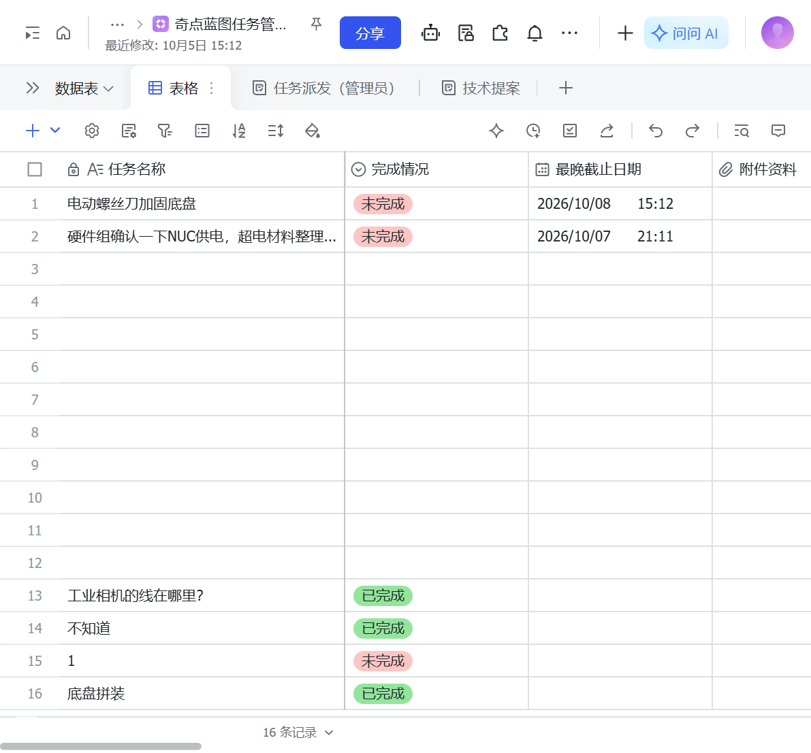

# 飞书运营系统案例：多维表格 + 机器人 + 面板

把战队运营里的任务、提案、物料库存、采购与合同收进飞书：**表单做入口、多维表格做数据、自动化做流程、机器人做交互、Flask 面板做实验室大屏**。

- 案例对象：辽宁工程技术大学「奇点蓝图」RoboMaster 战队（16 人、四个技术方向）
- 时间：2026.08 – 至今
- 角色：个人主导（需求、表结构、公式、自动化、机器人改造、面板后端、部署方案）

## 案例文档

- [王竣石_飞书运营系统案例.pdf](./王竣石_飞书运营系统案例.pdf)（4 页，含架构图、链路图、飞书截图、证据表、制造业迁移表）
- [Markdown 源稿](./docs/奇点蓝图飞书运营系统_案例.md)

## 方案结构

```
入口层    任务派发表单 │ 技术提案表单 │ 战队群 │ 机器人私聊
数据层    飞书多维表格（任务 / 提案同表，用「记录类型」区分）
流程层    6 条自动化：群发 · 私发执行人 · 完成通知 · 每日催办
                    · 提案提交通知 · 审批结果通知
交互层    任务卡片（✓ 标记完成 / ✓ 通过 / ✕ 驳回）· BOM / 采购 / 赞助机器人
展示层    Flask 任务面板（多维表格记录 + GitHub 贡献榜，实验室大屏）
```



## 关键数字（截至 2026-10-29）

| 项 | 数字 / 状态 |
|---|---|
| 任务后台 | 1 张表 / 17 条记录（含测试）/ 10 个字段 / 2 张表单 / 6 条自动化 |
| 看板 | 1 个仪表盘，6 个组件（任务总数、未完成、已完成、完成分布、待办排行、劳模榜） |
| 考核倒计时 | 2 张表（考核清单 2 条、进度 4 条）/ 11 + 7 个字段 / 1 条每日 12:30 自动化 |
| 机器人 | 3 个（BOM 库存、采购、赞助合同；BOM 为开源原型改造，后两个按同一模板新增） |
| 群覆盖 | 3 个（2027 赛季步兵、哨兵、硬件组），战队 16 人 |
| 面板 | Flask，`/api/feishu` + `/api/github`，端口 5010 |

## 边界说明

- BOM 机器人原型来自开源项目，本人接管改造；采购、赞助两个机器人按同一模板新增。
- 采购机器人代码完成、尚未上线。
- 17 条记录含测试数据，真实任务个位数；不宣称高频使用。
- 车辆进度（进度表）仍在完善，未作为本案例的成果展示。
- 案例是学生战队场景，不是制造业客户交付；「制造业场景」是迁移预演，不是客户项目。

## 代码结构

```
bom-manager-main/
├─ bom_inventory/        BOM 解析、库存 CRUD、会话状态机、飞书长连接机器人
├─ purchase_manager/     采购申请机器人（未上线）
├─ sponsor_contracts/    赞助合同机器人（状态机 + 多维表格同步）
├─ task_dashboard/       Flask 面板（多维表格记录 + GitHub 贡献榜）
└─ _launcher/            Windows 进程总管（单实例锁 + 自动重启）
```

> 本仓库只放案例文档与截图；业务代码与密钥不在仓库内。
